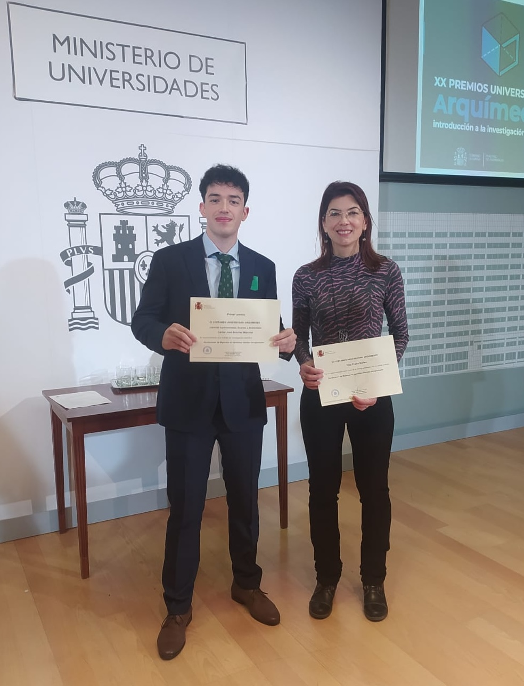

+++
title = "Awards"
+++

## Fundación Real Academia de Ciencias de España

@@row
@@column41  @@
@@column42
I was honored by the [Royal Academy of Sciences of Spain](https://rac.es) and [Mastercard](https://www.mastercard.com) with the "**Young Female Scientist 2021**" award.

### Press releases
- [Europapress](https://www.europapress.es/epsocial/responsables/noticia-cuatro-investigadoras-galardonadas-ii-premios-joven-talento-cientifico-femenino-2021-mastercard-frace-20211020151226.html)
- [Mastercard](https://www.mastercard.com/news/europe/es-es/noticias/notas-de-prensa/es-es/2021/octubre/la-frace-y-mastercard-entregan-los-premios-al-joven-talento-cientifico-femenino-2021/)
- [GEFES](http://gefes-rsef.org/premio-al-joven-talento-cientifico-femenino-2021-para-elsa-prada-socia-de-gefes/)
- [Colmenar Viejo](https://www.colmenarviejo.com/actualidad/3451-la-fisica-colmenarena-elsa-prada-nunez-gana-el-premio-al-joven-talento-cientifico-femenino-2021?fbclid=IwAR1p8il15uAGj9Ca3aADNoDB6nQmJo7n3E2Z6Cyw8kEOnD4hH87iFXvul0M)

### Video of the event
- [YouTube](https://www.youtube.com/watch?v=bYBpI-l2_T4) (my speech starts at minute 28)

### FECYT (Ministerio de Ciencia e Innovación)
- [#científicasinnovadoras](https://cientificasinnovadoras.fecyt.es/cientificas/elsa-prada-nunez)

@@
@@

## Certamen Universitario "Arquímedes"

@@row
@@column31  @@
@@column32
The Spanish Ministry of Universities awarded me the **first prize** in the [Certamen Universitario "Arquímedes" 2023](https://www.universidades.gob.es/certamen-universitario-arquimedes-convocatoria-2022/) as **supervisor of the winning research project**.

### Press releases
- [ICMM News](https://www.icmm.csic.es/es/actualidad-y-divulgacion/carlos-jose-sanchez-primer-premio-arquimedes-por-su-tfg-realizado-en-el)

@@
@@