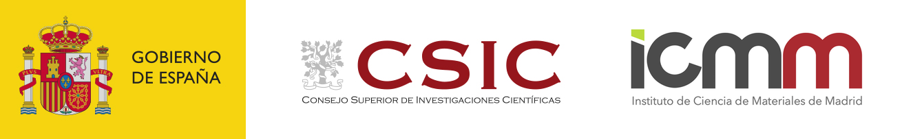
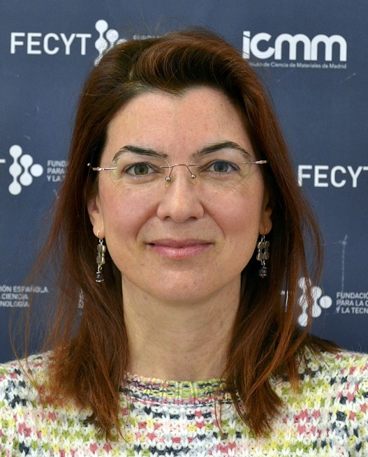

@def title = "Elsa Prada's homepage"
@def tags = ["syntax", "code"]

@@img-medium  @@

@@row
@@column11  @@

@@column12

\style{text-align:center;width:100%;display:inline-block;line-height: 1.2em; padding-bottom: 2em}{
  **INSTITUTO DE CIENCIA DE MATERIALES DE MADRID - CSIC**\\
  C/ Sor Juana Inés de la Cruz 3, E-28049 Cantoblanco, Madrid, Spain\\
  Office: 346 — Tel.: (+34) 91 334 9080\\
  E-mail: [elsa.prada@csic.es](mailto:Elsa Prada<elsa.prada@csic.es>)}

Hi! My name is **Elsa Prada** and I am a Senior Researcher at the [Materials Science Institute of Madrid](https://www.icmm.csic.es/) (which is part of the [Spanish Research Council](https://www.csic.es/)). Within the department of Theory and Simulation of Materials, our group is called [Quantum Dynamics and Materials (QUDYMA)](https://sites.google.com/view/qudyma-icmm).

I am a **condensed matter theorist** working on the modeling and simulation of quantum materials and devices, with an eye on their applications in quantum technologies. My research lies at the frontier between fundamental physics and applications: I am interested in how quantum phenomena such as superconductivity, topology and quantum coherence emerge in real, imperfect systems, and how they can be engineered, controlled and detected in the laboratory.

Over the years, my work has evolved from entanglement and quantum transport in mesoscopic conductors, through graphene and other two-dimensional crystals, to hybrid superconductor-semiconductor nanostructures, a leading platform in the search for Majorana zero modes and topological qubits. My current work focuses on full-shell hybrid nanowires, Andreev states and Josephson devices, the superconducting diode effect, and rhombohedral multilayer graphene.

A distinctive part of my research is providing theoretical support to experimental groups. I develop realistic models that capture the geometry, electrostatics and material properties of actual devices, so that theory can be compared directly with measurements, help interpret them, and guide the design of new experiments.

@@
@@

## Identifiers
- [Google Scholar](https://scholar.google.com/citations?user=-XI445sAAAAJ&hl=en)
- ORCID: [0000-0001-7522-4795](http://orcid.org/0000-0001-7522-4795)
- Web of Science: [A-4792-2010](https://www.webofscience.com/wos/author/record/1465075)
- Scopus: [9238304800](https://www.scopus.com/authid/detail.uri?authorId=9238304800)

